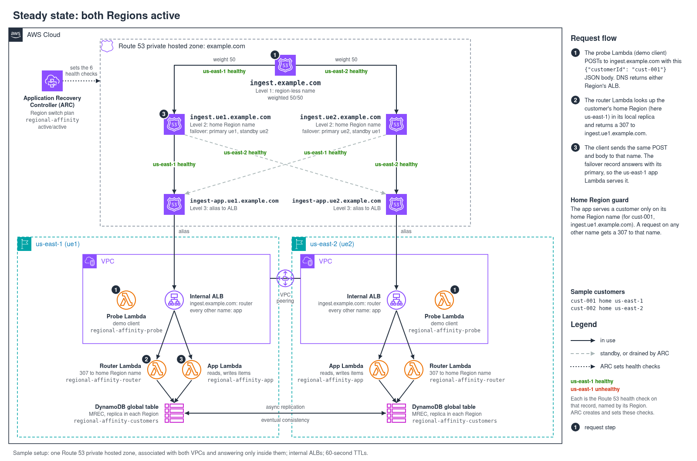
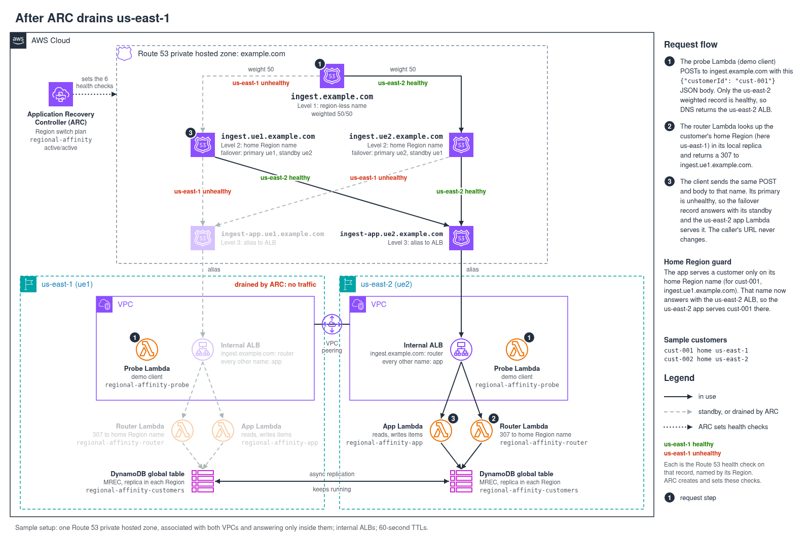

# Home Region routing with Amazon Route 53, an Amazon DynamoDB global table and Amazon Application Recovery Controller (ARC) Region switch

Deploy this two-AWS-Region sample in your account to give each customer a home Region for its reads and writes. Clients call one region-less name. A thin router redirects each request to the name of its customer's home Region, and one Amazon Application Recovery Controller (ARC) Region switch plan execution drains or restores a Region at every level of a three-level Amazon Route 53 hierarchy. When a Region is drained, its customers are served in the other Region on the same name, with no change on the client's side. The data lives in an Amazon DynamoDB global table that uses multi-Region eventual consistency (MREC).

## Architecture



The records live in a Route 53 private hosted zone associated with both VPCs:

```
ingest.example.com                       weighted 50/50, ARC health check on each record
├── ingest.ue1.example.com               failover, ARC health check on each record (us-east-1 home Region name)
│   ├── PRIMARY    → ingest-app.ue1.example.com → internal ALB, us-east-1
│   └── SECONDARY  → ingest-app.ue2.example.com → internal ALB, us-east-2
└── ingest.ue2.example.com               failover, ARC health check on each record (us-east-2 home Region name)
    ├── PRIMARY    → ingest-app.ue2.example.com → internal ALB, us-east-2
    └── SECONDARY  → ingest-app.ue1.example.com → internal ALB, us-east-1
```

A request for a customer whose home Region is us-east-1:

```
POST http://ingest.example.com/write
     {"customerId": "cust-001", "key": "demo", "value": {"note": "hi"}}
 1. DNS answers with either Region's Application Load Balancer (ALB), weighted 50/50
 2. the ALB's rule for the region-less name invokes the router, which reads the customer from the
    body and its home Region from that Region's replica: 307 Location: http://ingest.ue1.example.com/write
 3. the client repeats the POST, same body, on ingest.ue1.example.com
 4. DNS answers with the us-east-1 ALB, or with the us-east-2 ALB while ARC has us-east-1 drained
 5. the ALB invokes the app, which writes the item to that Region's replica of the global table
```

A 307 tells the client to repeat the same method and body at the new location. The router never checks whether the home Region is up. When the plan drains us-east-1, the failover record of `ingest.ue1.example.com` answers with its SECONDARY, the us-east-2 ALB, so the same redirect lands there:



**The plan.** The plan is `activeActive`. ARC creates and owns one Route 53 health check per Region for each of the three ARC-controlled names, six in all, and starts them healthy, so the region-less name answers 50/50 at rest. The plan's deactivate workflow marks the target Region's three checks unhealthy in one parallel step; its activate workflow marks them healthy again. On each home Region name, the PRIMARY answers while its check is healthy. The SECONDARY's check is healthy too, but Route 53 answers with a SECONDARY only while its PRIMARY is unhealthy. Every record's set identifier is the Region it sends traffic to, and the records stack binds each record to the health check ARC vended for that name and Region.

**The home Region guard.** The app serves a customer's request only when it arrives on that customer's home Region name. It answers a request on any other name, including the other Region's name and the app names, with a 307 to the home Region name. Which Region serves that name is DNS's decision, and so the plan's.

## How the home Region works

This is the DynamoDB global tables [write to your Region mode (mixed primary)](https://docs.aws.amazon.com/prescriptive-guidance/latest/dynamodb-global-tables/write-to-your-region.html): each item has a home Region, and writes to an item go through its home Region only. The disaster recovery whitepaper calls the same idea a [write partitioned](https://docs.aws.amazon.com/whitepapers/latest/disaster-recovery-workloads-on-aws/disaster-recovery-options-in-the-cloud.html) strategy. It is not sharding: both Regions hold every customer's data, so a drained Region's customers find their data in the other Region.

- **Home Regions.** Each customer has a `profile` item that names its home Region. `make deploy` writes 300 sample customers, `cust-001` to `cust-300`: odd-numbered customers have their home in us-east-1, even-numbered ones in us-east-2. The customer's data items sit in the same partition.
- **Local reads.** Each Region's router and app can reach only that Region's replica. The app reads with strong consistency, which within a Region reflects every write that Region accepted.
- **Conflicts.** Replication between the replicas is asynchronous, and when both Regions write the same item, the last writer wins. Keeping each customer's writes in one Region avoids conflicts in normal operation.
- **The switch window.** Answers are cached for their 60-second TTL. For up to that long after a drain or a restore, clients holding the old answer still reach the other Region on the home Region name, while others already reach the new one, so both Regions can accept the same customer's writes. The guard cannot tell the two apart, because both requests arrive on the right name. In a real Regional impairment, writes that the drained Region accepted but had not yet replicated arrive later, or not at all while the impairment lasts.

## Resources deployed

| Stack | AWS Region | Core resources |
|---|---|---|
| `regional-affinity-region-us-east-1` | us-east-1 | VPC `10.11.0.0/16` with two isolated subnets (no internet gateway, no NAT gateway), internal ALB, router, app and probe functions, peering connection to the second VPC |
| `regional-affinity-region-us-east-2` | us-east-2 | VPC `10.12.0.0/16`, same resources, return route over the peering connection |
| `regional-affinity-data` | us-east-1 | Global table `regional-affinity-customers` (on-demand, MREC, point-in-time recovery) with a replica in us-east-2 |
| `regional-affinity-plan` | us-east-1 | Private hosted zone `example.com` associated with both VPCs, plan execution role, `activeActive` Region switch plan |
| `regional-affinity-records` | us-east-1 | The ten records above, created bottom-up |

The probe function runs inside each VPC. `scripts/demo.py` invokes it to query the VPC's Route 53 Resolver and to send HTTP requests that follow redirects, because the private hosted zone answers only inside the two VPCs. The VPCs are peered so the probe can reach whichever Region's ALB an answer names.

## Prerequisites

Deploy this sample into a sandbox AWS account. It needs one free VPC in each Region (the default quota is 5 per Region) and one Region switch plan (10 per account).

- AWS CDK bootstrapped in `us-east-1` and `us-east-2`.
- AWS CLI v2. Pass `PROFILE=<name>` to `make`, set `AWS_PROFILE`, or use the default credential chain.
- Node.js 20 or later, Python 3.9 or later, and `make`. The scripts use only the Python standard library.
- Optional: `ACCOUNT=<12-digit account ID>` makes every target refuse to run against any other account.

Set `REGIONS`, `DOMAIN` and `APP_LABEL` to change the defaults (`us-east-1,us-east-2`, `example.com`, `ingest`). A Region's label in its names is the first letter of each word plus its number: `ue1` for us-east-1, `uw2` for us-west-2. `PROJECT` (default `regional-affinity`) prefixes every stack and named resource.

## Deploy

```bash
npm ci
make deploy PROFILE=<aws-profile>
make help
```

From an empty account, `make deploy` takes about 13 minutes. It deploys the two Region stacks and the table in parallel, seeds the customers and confirms the second replica has them, adds the peering connection, deploys the plan, waits for ARC to vend the six health checks, deploys the records with their IDs, and verifies that every record carries the right check. The plan exists before its records, so its first evaluation warns that the records are missing; the last step makes ARC evaluate the plan again at both Regional endpoints and fails on any remaining warning. Running `make deploy` again updates the stacks in place and keeps the peering connection.

**Cost:** about $0.15 per hour while deployed, mostly the Region switch plan ($70 per plan per month, prorated) and two idle ALBs. The table is on-demand and holds a few hundred small items, VPC peering has no hourly charge, and the functions run only when called. There are no NAT gateways. Run cleanup after testing.

## Try it

| Step | Command | What to look for |
|---|---|---|
| Steady state | `make status` | All six ARC health checks healthy, with each home Region name's primary answering and its standby waiting. `cust-001` is redirected to `ingest.ue1.example.com` and served in us-east-1, `cust-002` to `ingest.ue2.example.com` and served in us-east-2. The last request sends `cust-001` straight to `ingest.ue2.example.com`, and the app's guard redirects it to `ingest.ue1.example.com`. |
| Write and read | `make call CUSTOMER=cust-005` | A read (no item yet), a write and a read, each through the region-less name. All three are served in us-east-1, cust-005's home Region. |
| Drain | `make drain REGION=us-east-1` | Starts the plan's deactivate workflow for us-east-1 at the us-east-2 endpoint (a deactivate runs in the Region that stays), follows its steps (about 2 minutes), waits for DNS to follow, then shows the status. us-east-1's checks are unhealthy and the standby of `ingest.ue1.example.com` answers. |
| During the drain | `make call CUSTOMER=cust-005` | The same requests, served in us-east-2. The read returns the item written in us-east-1 before the drain, because the table replicated it. |
| Restore | `make restore REGION=us-east-1` | Starts the activate workflow at the us-east-1 endpoint. Afterwards a call reads, in us-east-1, the value written in us-east-2 during the drain. |
| Rehearse | `make rehearse` | Drains and restores each Region in turn, and fails if DNS, the Region that serves a request, or the data a Region reads differs from what the plan state predicts. The e2e workflow runs this. |

`make drain` refuses to drain a Region while the other one is drained. `FROM=us-east-1` sends the queries and requests from the us-east-1 VPC instead; the private zone gives the same answers in both VPCs. During an execution, the plan's page in the ARC console shows the parallel step and each health check's state.

Reading the output:

- In the health check table, each cell shows the record's role (`weighted`, `primary`, or `standby`, which is Route 53's SECONDARY), its check's state, and `answering` when Route 53 returns that record for those states.
- Addresses in `10.11.0.0/16` belong to the us-east-1 ALB and those in `10.12.0.0/16` to the us-east-2 ALB; the tables label them by Region.
- In the request tables, each line under a request is one response: the name it went to, the ALB address, the status code, and what the router or app said. `ok` means every redirect pointed at the customer's home Region name and the app that answered runs in the Region that name resolves to now. "(not its home Region)" marks an item served outside its customer's home Region, which happens only while that Region is drained.
- `DIFFERS` right after an execution is usually DNS caching; answers can lag by up to their 60-second TTL. A short sample of the region-less name can show only one Region, because each weighted answer is cached for its TTL; `make status` takes 20 samples per name half a second apart.

## Adapting it

- **Public hosted zone.** The records, plan and routing are the same with a public zone for a domain you own.
- **TLS.** Each ALB needs a certificate for the region-less name and both home Region names, because during a drain the surviving Region's ALB answers for the drained Region's name. A wildcard such as `*.example.com` matches one label, so it covers the region-less name but not `ingest.ue1.example.com`. The router and the guard already redirect with the scheme the client used.
- **Clients.** A client must follow a 307 and repeat the method and body. `curl -L` and the Python `requests` library do. A client can keep the home Region name for later requests for the same customer; it stays correct through a drain, so only the first request pays for the redirect.
- **The customer in the body.** Reads are POSTs too, because many clients and proxies drop the body of a GET. The router parses every request's body to find the customer, and an ALB passes at most 1 MB of request body to a Lambda function. A router that sees only headers and the URL, such as a CloudFront Function, cannot route on a body field.
- **Routing lookups.** The router reads the customer's profile item for each region-less request. A short in-memory cache would cut those reads, at the cost of a reassigned customer taking up to the cache lifetime to move.
- **ALB target health.** With ALBs in front of real targets, add `-c albEvaluateTargetHealth=true` to the `records` target in the `Makefile`, so a Region whose targets are all unhealthy stops answering before ARC acts. The sample leaves it `false` because its Lambda targets have health checks off, so their target health carries no information.
- **More services in one plan.** A plan holds at most [25 Route 53 health check execution blocks](https://docs.aws.amazon.com/r53recovery/latest/dg/quotas.region-switch.html). This layout needs six per service (three names, in both workflows), so one plan covers four services. For more, attach each service's region-less checks to its home Region records as well (two blocks per service), or split the services across plans and start them from a parent plan with the Region switch plan execution block.
- **Other execution blocks.** The execution role holds only what Route 53 health check blocks and plan evaluation need. Blocks for Amazon EKS, Amazon Aurora or AWS Lambda need their own documented permissions.

## Cleanup

```bash
make clean PROFILE=<aws-profile>
```

You can also run `./cleanup.sh`. Cleanup deletes the records, then the plan, then the Region stacks and the table, and takes about 25 minutes, most of it while Lambda releases the probe's network interfaces. Re-run it after a failure: a stack whose deletion fails is retried once, and cleanup prints the failing resources and exits non-zero if any stack remains.

## Security

Report security issues through Security issue notifications in [CONTRIBUTING.md](../CONTRIBUTING.md).

The sample's API has no authentication and uses plain HTTP. The ALBs are internal and accept connections only from the two sample VPCs, which have no internet gateway or NAT gateway; the only thing running in them is the probe function, and invoking it needs `lambda:InvokeFunction` in the account. The data is synthetic. A production front door needs TLS (see above) and the application's own authentication.

The records use `example.com`, which [RFC 2606](https://www.rfc-editor.org/rfc/rfc2606) reserves for documentation. Inside the two VPCs the private hosted zone answers first, so the sample's requests never leave them. Set `DOMAIN` to a domain you own before you adapt the sample to a public hosted zone.

The cdk-nag AwsSolutions exceptions are listed with their reasons in [`lib/nag.ts`](lib/nag.ts): `AwsSolutions-IAM4` (the documented Lambda execution policies), `AwsSolutions-IAM5` (the plan execution role reads its own plan, whose ARN ARC generates), `AwsSolutions-ELB2` (no ALB access logs) and `AwsSolutions-VPC7` (no VPC flow logs). `test/nag.test.ts` fails on any other finding.

## Limits

The sample uses two Regions, one plan, and a private hosted zone. Every `make` target is non-interactive and prints the account it acts on. `make test` runs the CDK assertion tests and the Python unit tests without AWS access.

## License

MIT-0. See [LICENSE](../LICENSE).
